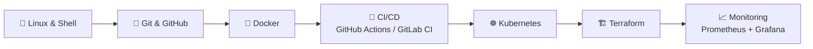

<!-- ===================== HEADER ===================== -->

---

## 👨‍💻 About Me

  

  <i>I like systems that are simple to run, easy to observe, and boring to operate.</i>

---

## 🚀 Languages & Tools

  &nbsp;
  &nbsp;
  &nbsp;
  &nbsp;
  &nbsp;
  &nbsp;
  &nbsp;
  &nbsp;
  &nbsp;
  &nbsp;
  &nbsp;
  &nbsp;
  &nbsp;
  &nbsp;
  &nbsp;
  &nbsp;
  &nbsp;
  &nbsp;
  &nbsp;
&nbsp;

---

## 🚀 Featured Projects

| Project | What it does | Built with |
|:--------|:-------------|:-----------|
| [**Shipora**](https://github.com/chaovanthoung168/shipora) | Self-hosted deployment platform that connects GitHub repositories and manages Docker Compose deployments from one dashboard. | `Java` `Spring` `Docker` `Kubernetes` |
| [**ITP-MBanking-Microservice**](https://github.com/chaovanthoung168/ITP-MBanking-Microservice) | Mobile-banking backend split into account and customer services, with service discovery, gateway, Kafka events, Redis and Vault. | `Spring Boot` `Eureka` `Kafka` `Redis` `Next.js` |
| [**Banking System (Python)**](https://github.com/chaovanthoung168/banking-system-python) | Console banking app built with layered MVC, service/repository abstractions and unit tests. | `Python` `OOP` `MVC` `unittest` |

---

## 🗺️ My DevOps Learning Roadmap

---

## 📊 GitHub Stats

 

---

## 🤝 Connect With Me

  

💬 *Feel free to reach out if you want to collaborate on projects or just have a tech chat!*

> "First, solve the problem. Then, write the code. Then, automate the deploy." ⚡

